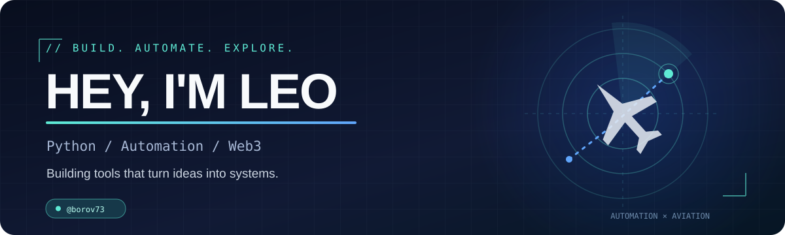

<div align="center">
  

  <br />

  

  <br />

  <a href="https://github.com/borov73?tab=repositories"></a>
  <a href="https://github.com/borov73"></a>
</div>

## 👋 About me

I'm **Leo** — a Python developer interested in **automation**, **Web3**, and **aviation**.

I enjoy turning repetitive tasks into useful tools, exploring blockchain infrastructure, and learning better ways to build and ship software.

- ⚙️ **Automation:** workflows, bots, integrations, and practical tooling
- ⛓️ **Web3:** on-chain interactions, blockchain infrastructure, and EVM ecosystems
- ✈️ **Aviation:** a major part of my interests beyond software
- 🚀 **Currently exploring:** AI-assisted development with Codex, Git, and GitHub workflows

## 🧰 Tech & tools

<div align="center">
  
</div>

<p align="center"><code>Python</code> · <code>Web3.py</code> · <code>APIs</code> · <code>Git</code> · <code>Automation</code> · <code>macOS</code></p>

## 🚀 Featured work

<table>
<tr>
<td width="50%" valign="top">

### 🔐 [vpn_payment](https://github.com/borov73/vpn_payment)

A Telegram bot project for tracking VPN payments in ETH on Base, with EUR balances and reminders.

**Focus:** Telegram · Web3 · Payments · Automation

</td>
<td width="50%" valign="top">

### 🧪 [first_repository](https://github.com/borov73/first_repository)

My early GitHub playground for experimenting with repositories, version control, and development workflows.

**Focus:** Learning · Git · GitHub

</td>
</tr>
</table>

## 📡 What I'm focused on

```text
AUTOMATION     [██████████]  Python tools & workflows
WEB3           [██████████]  EVM and on-chain interactions
AI WORKFLOWS   [██████████]  Codex-assisted development
AVIATION       [██████████]  Always on my radar
```

## 📊 GitHub activity

<div align="center">
  
</div>

> Note: The GitHub statistics card is hosted by an external community service, so it may occasionally be unavailable. GitHub's native contribution graph remains visible on my profile.

---

<div align="center">
  <sub>Build thoughtfully. Automate relentlessly. Keep exploring. ✈️</sub>
</div>
