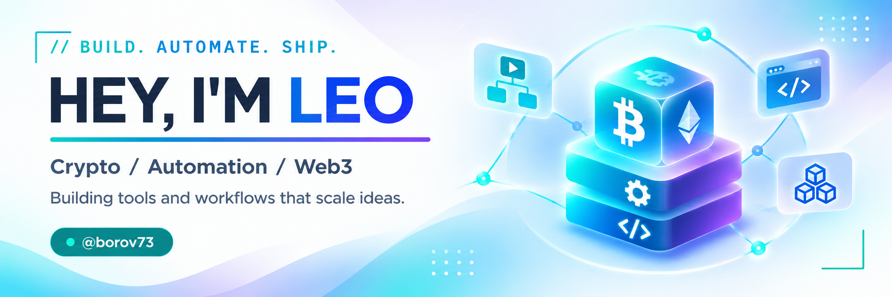

<div align="center">
  

  <br />

  

  <br />

  <a href="https://github.com/borov73?tab=repositories"></a>
</div>

## 👋 About me

I'm **Leo** — a Python developer focused on **crypto**, **automation**, and **Web3**.

I build practical tools that simplify repetitive workflows and explore blockchain infrastructure, EVM networks, and on-chain integrations.

- ⚙️ **Automation:** bots, workflows, APIs, and integrations
- 🪙 **Crypto & Web3:** EVM networks, wallets, on-chain actions, and infrastructure
- 🚀 **Currently exploring:** AI-assisted development with Codex, Git, and GitHub

## 🧰 Tech & tools

<div align="center">


</div>

## 🚀 Featured work

| Project | Description |
|:--|:--|
| 🔐 [vpn_payment](https://github.com/borov73/vpn_payment) | Telegram bot project for VPN payments using ETH and automation. |
| 🧪 [first_repository](https://github.com/borov73/first_repository) | A space for practicing Git, GitHub, and development workflows. |

## 🎯 Current focus

```text
CRYPTO       → On-chain interactions and blockchain infrastructure
AUTOMATION   → Bots, APIs, and scalable workflows
WEB3         → EVM ecosystems and practical tooling
AI WORKFLOW  → Codex, Git, and GitHub
```

## 📊 GitHub activity

<div align="center">
  
</div>

<div align="center">
  <sub>Build useful things. Automate what matters. Keep shipping. ⚡</sub>
</div>
